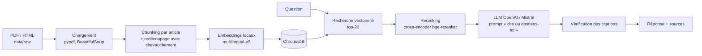

# ⚖️ RAG Legal Assistant

Assistant de questions-réponses sur des **textes juridiques belges** et des **règlements universitaires**,
qui répond **uniquement à partir des documents** et **cite ses sources** (fichier, article, page).
S'il ne trouve pas la réponse, il le dit au lieu d'inventer.


## Le problème

Un code de loi fait des centaines de pages. Un LLM seul « hallucine » des articles qui n'existent pas.
Objectif : des réponses **vérifiables**, chaque affirmation étant reliée à un extrait précis du texte source.

## Architecture



### Choix techniques

| Choix | Pourquoi |
|---|---|
| **Chunking par article** | Un article de loi est l'unité qu'on cite. Couper au hasard tous les 1000 caractères mélange deux articles dans un même chunk et dégrade la citation. |
| **Embeddings locaux `multilingual-e5-small`** | Gratuits, bons en français, et pas d'envoi des documents à une API pour l'indexation. |
| **Reranking cross-encoder** | La recherche vectorielle ramène 20 candidats vite ; le cross-encoder lit question + passage ensemble et garde les 5 plus pertinents. |
| **Contexte numéroté + validation** | Le LLM doit citer `[n]`. Le code vérifie ensuite qu'aucune citation ne pointe vers une source inexistante. |
| **Fournisseur configurable** | OpenAI ou Mistral via une seule variable `LLM_PROVIDER`. |

## Démarrage rapide

```bash
git clone https://github.com/abderrahimseddiki/rag-legal-assistant.git
cd rag-legal-assistant
python -m venv .venv && source .venv/bin/activate   # Windows : .venv\Scripts\activate
pip install -r requirements-dev.txt
cp .env.example .env                                  # puis renseigne ta clé API
```

1. Place tes documents dans `data/raw/` (sources suggérées : [docs/DATA.md](docs/DATA.md)).
2. Indexe-les :
   ```bash
   PYTHONPATH=src python -m rag_assistant.cli ingest
   ```
3. Pose une question :
   ```bash
   PYTHONPATH=src python -m rag_assistant.cli ask "Quel est le délai de recours après une délibération ?"
   ```
4. Ou lance l'API :
   ```bash
   PYTHONPATH=src uvicorn rag_assistant.api:app --reload
   # http://localhost:8000/docs
   ```

Avec Docker : `docker compose up --build`.

## Évaluation

Le script `eval/evaluate.py` calcule automatiquement les métriques sur un jeu de questions annoté
(format et conseils dans [docs/DATA.md](docs/DATA.md)) :

```bash
PYTHONPATH=src python eval/evaluate.py --questions eval/questions.jsonl
```

| Métrique | Définition |
|---|---|
| `retrieval_hit_rate` | La bonne source (et le bon article) est dans le top-5 |
| `accuracy` | Réponse correcte par rapport à la référence (LLM juge) |
| `hallucination_rate` | Réponses contenant une affirmation non soutenue par les extraits |
| `abstention_accuracy` | Questions hors corpus correctement refusées |
| `citation_validity` | Réponses sans citation inventée |

### Résultats

> ⏳ À compléter après le premier run d'évaluation — résultats réels, avec le nombre de questions et la configuration.

| Configuration | Questions | Hit@5 | Accuracy | Hallucination | Abstention |
|---|---|---|---|---|---|
| e5-small + reranker + gpt-4o-mini | – | – | – | – | – |
| e5-small sans reranker + gpt-4o-mini | – | – | – | – | – |

## Structure

```
src/rag_assistant/
├── config.py       # paramètres (.env)
├── loaders.py      # PDF / HTML / TXT -> texte
├── chunking.py     # découpage par article (Python pur, testé)
├── embeddings.py   # embeddings locaux avec préfixes E5
├── store.py        # ChromaDB
├── ingest.py       # pipeline d'indexation
├── retriever.py    # recherche + reranking
├── llm.py          # OpenAI / Mistral
├── citations.py    # contexte numéroté + validation des citations
├── chain.py        # orchestration
├── api.py          # FastAPI
└── cli.py          # ligne de commande
eval/evaluate.py    # évaluation automatique
tests/              # tests unitaires (pytest)
```

## Limites et pistes

- Les PDF scannés nécessitent un OCR (non inclus).
- Le LLM juge de l'évaluation peut se tromper : vérifier manuellement un échantillon.
- Pistes : recherche hybride BM25 + vecteurs, interface Streamlit, suivi des versions des lois.

## Auteur

**Abderrahim Seddiki** — [GitHub](https://github.com/abderrahimseddiki)
